# Screenshots

Captured on Wednesday 4 November 2026 on an **iPhone 17 Pro simulator** (iOS, debug build, status bar fixed at 9:41), then downscaled to 1000 px tall. The events are real: each tap went through the SDK into its database, and the Dashboard shows the queue as it was.

## Light

| Home | Shop | A product, after Buy |
|:---:|:---:|:---:|
| 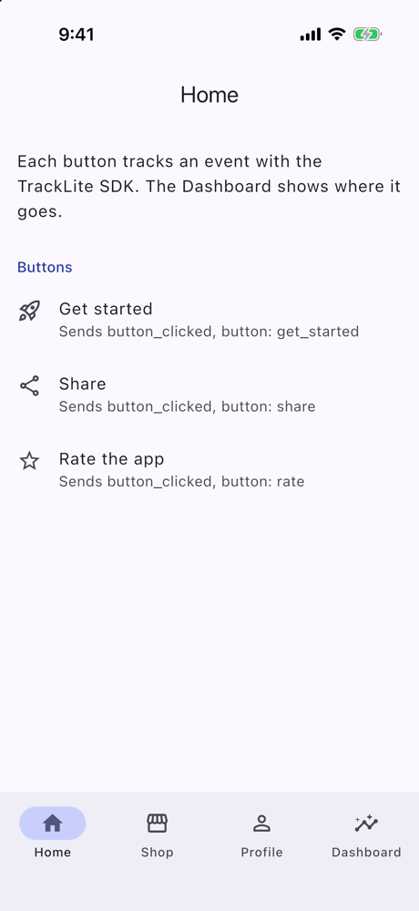 | 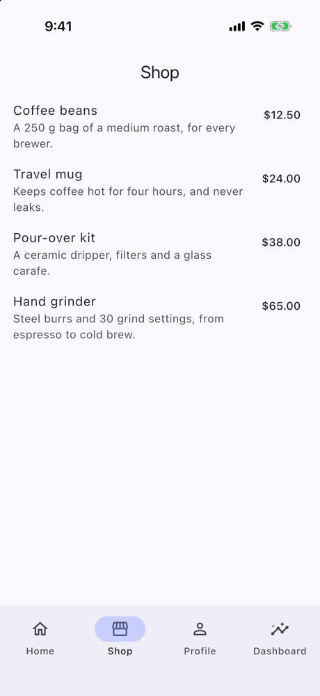 | 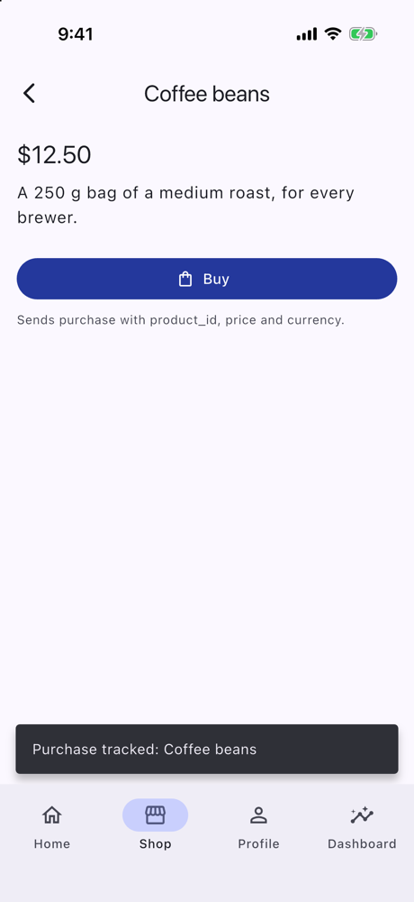 |

| Profile, signed in | The Dashboard |
|:---:|:---:|
| 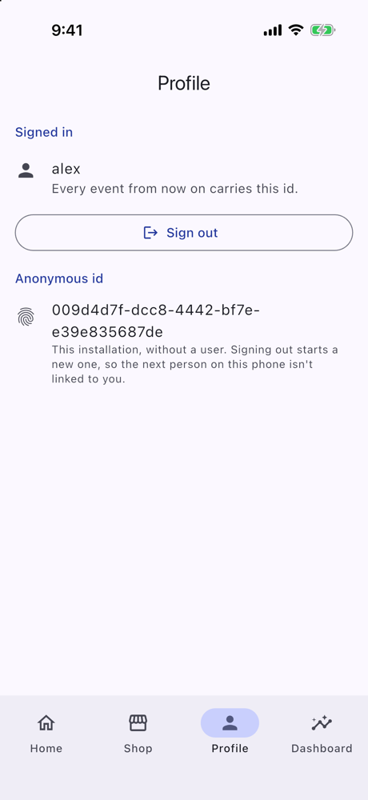 | 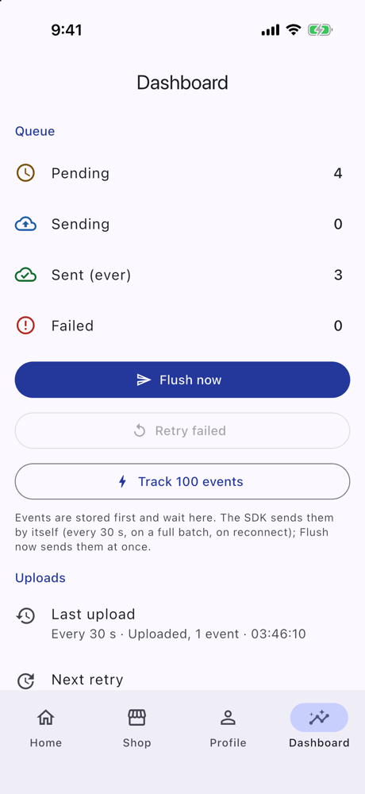 |

## Dark: failures and offline

The Dashboard's demo controls: the fake server's **Failures** at 100 %, then **Track 100 events**.

| The demo server | Failing, with backoff | Device offline | Recent events |
|:---:|:---:|:---:|:---:|
| 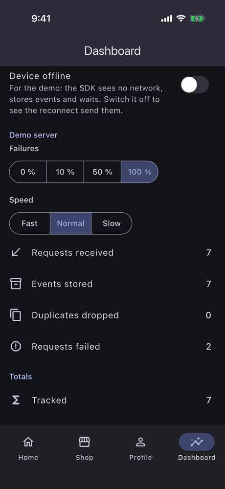 | 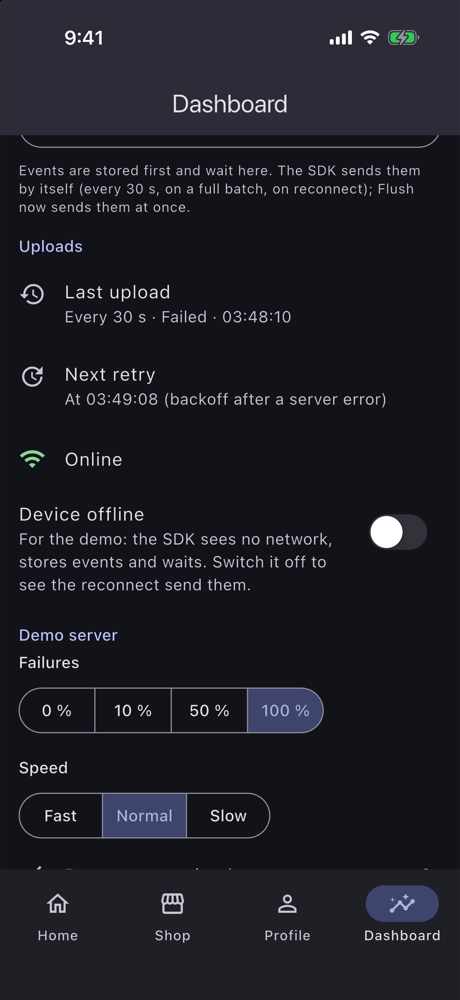 | 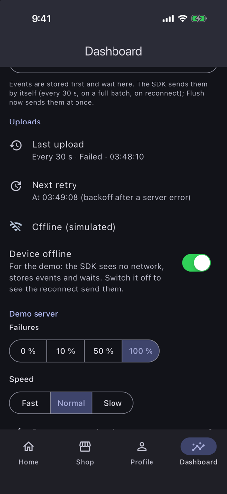 | 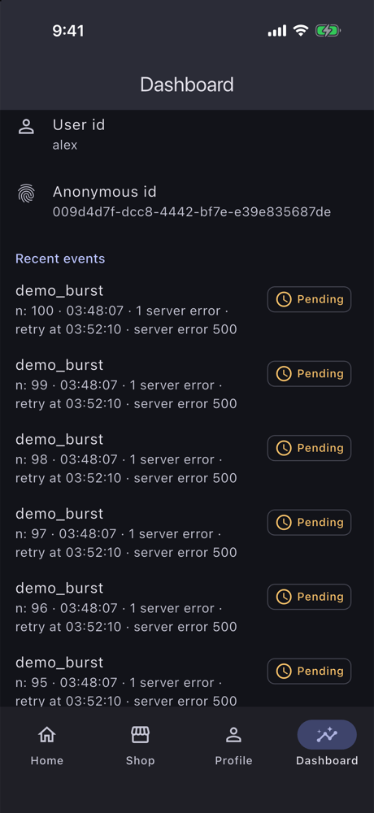 |

## Large text

Accessibility text size **AX3** (about 235 %), light mode. Past 130 %, side-by-side layouts stack: the segments become wrapping chips, and an event's status chip moves under its details, so `screen_opened` isn't broken mid-word.

| Profile | The Dashboard | Recent events |
|:---:|:---:|:---:|
| 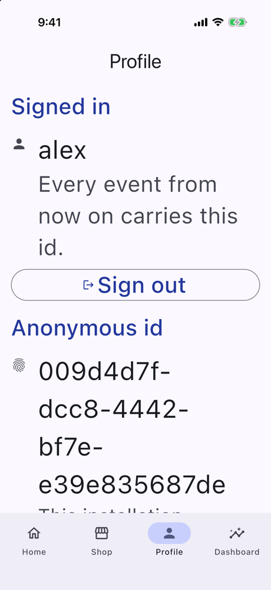 | 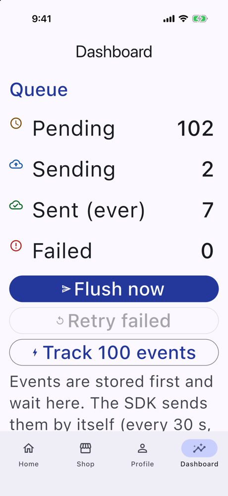 | 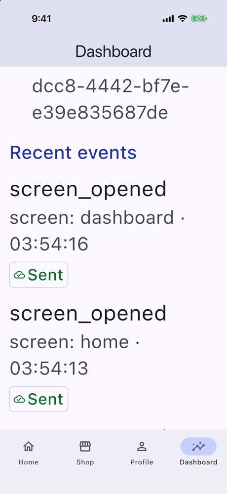 |

"Sending 2" in the large-text Dashboard is the at-least-once path, caught by accident: the app was relaunched mid-upload, so those two claims stay `sending` until they expire (5 minutes), then go again.
